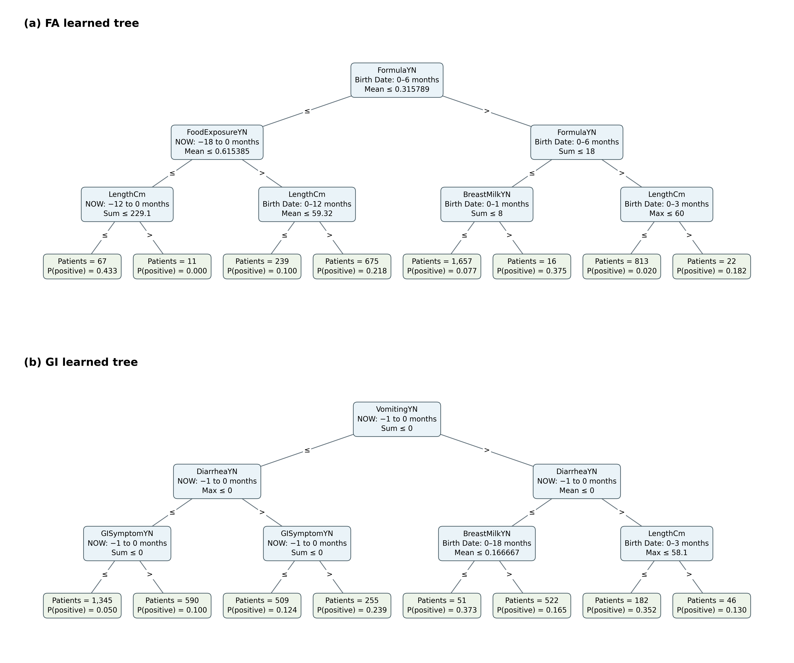
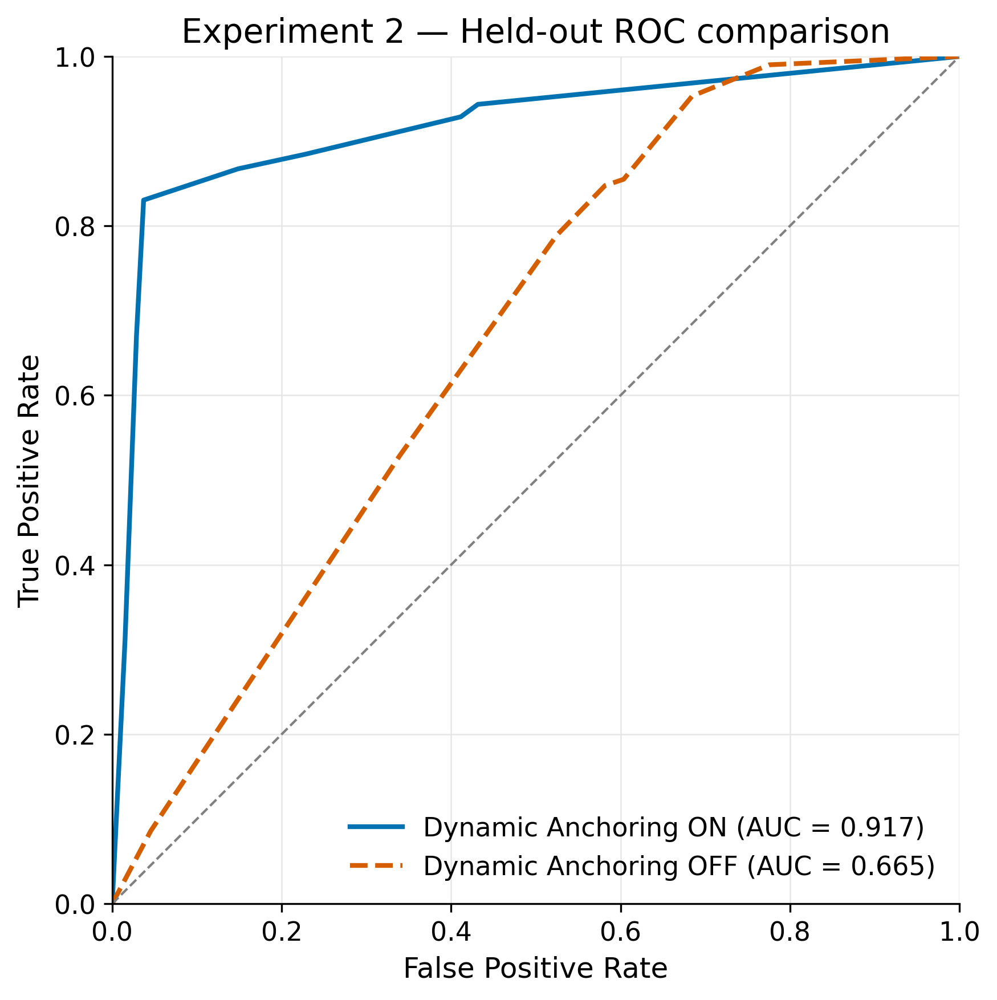

# Results and Visualizations

## Findings from saved results

The following ROC-AUC values use the saved held-out predictions. Experiment 1 and
Experiment 2 use different cohorts and splits; comparisons across those studies
are not controlled comparisons.

| Study / model | TEST ROC-AUC |
| --- | ---: |
| Experiment 1 — FA | 0.6361 |
| Experiment 1 — GI | 0.6716 |
| Experiment 1.1 — GI without NOW, gain 0 | 0.4895 |
| Experiment 1.1 — GI without NOW, gain 0.0005 | 0.5000 |
| Experiment 2 — Dynamic ON, seed 42 | 0.9171 |
| Experiment 2 — Dynamic OFF, seed 42 | 0.6647 |
| Experiment 2.1 — Dynamic ON, seeds 43–47, mean ± SD | 0.8700 ± 0.0454 |
| Experiment 2.1 — Dynamic OFF, seeds 43–47, mean ± SD | 0.6534 ± 0.0055 |
| CART — final 100/50 baseline on Experiment 2 | 0.6552 |

The Experiment 2.1 values above describe the preserved five-seed archive.
New robustness runs use seeds 43–46 and compute their own four-seed summaries;
their aggregate values are not compared to the historical five-seed means.

Sources: [Experiment 1 comparison](../experiments/results/experiment_1_5000V3clean__moreOFFSETS2_patients_A=0.4_minS20_minL10_minGAIN0.0005/comparison_summary.json),
[GI gain-0 comparison](../experiments/results/experiment_1_1_gi_without_now_A0.4_minGAIN0/comparison_with_original_gi.csv),
[GI gain-0.0005 predictions](../experiments/results/experiment_1_1_gi_without_now_A0.4_minGAIN0.0005/gi/test_predictions.csv),
[Experiment 2 comparison](../experiments/results/experiment_2_noisy_matched_v2/comparison.json),
[robustness summary](../experiments/results/experiment_2_1_candidate_sampling_robustness/summary/auc_summary.csv),
and [CART results](../experiments/results/experiment_2_cart_baseline/run_20261014T110752808924Z_5f1eab64/results.csv).
The gain-0.0005 value was calculated from its saved scores because that archive
has no metrics JSON.

The recorded FA root uses MEAN(FormulaYN) in the birth-to-six-month window; the GI
root uses SUM(VomitingYN) in the final month relative to NOW. Removing NOW reduces
GI ranking performance in the retained runs. Dynamic ON outperforms Dynamic OFF
in all five retained robustness seed pairs on the full TEST cohort. These findings
are specific to the synthetic designs and fixed splits.

Saved outputs can be inspected directly. For example, this command only reads a
summary CSV:

```bash
python -B -c "import pandas as pd; print(pd.read_csv('experiments/results/experiment_2_1_candidate_sampling_robustness/summary/auc_summary.csv').to_string(index=False))"
```

Example saved figures:





Outcome directories contain JSON trees and temporal-usage tables. Experiment 2
also has `anchor_trace.json` per model; the robustness `summary/` contains paired
AUC and temporal stability analyses; the CART directory contains its tree and
comparison ROC figure.

## Recreate illustrations from saved inputs

These commands perform no data generation or model training. They write to new
locations under `figures/`; choose another destination if one already exists.

```bash
python -B experiments/visualize_experiment_1_timelines.py --output figures/experiment1_timelines_reproduced.png
python -B experiments/visualize_experiment_2_noisy_matched_v2_patients.py --output figures/experiment2_patients_reproduced
python -B -m experiments.plot_experiment_2_combined_roc --output figures/experiment2_six_seed_roc_reproduced.png
python -B -m experiments.experiment_2_temporal_explainability --results experiments/results/experiment_2_noisy_matched_v2 --output figures/experiment2_transition_reproduced --verify-current
```

The timeline scripts produce PNG/PDF pairs; the Experiment 2 script also records
selection provenance. The combined ROC plot reads twelve saved curves across
seeds 42–47. Anchor-transition post-processing produces PNG/PDF, CSV, and an audit
JSON. Its “before/after” boundary is traversal order around first fish-anchor
creation, includes the creating split in “before/at”, and considers only TEST
patients with a created fish anchor.

The optional probability-histogram command reads saved simulation ground truth
and **refreshes the existing histogram PNG** in the data directory:

```bash
python -B plot_true_probability_histograms.py --data-dir data/temporal_benchmark_v3_clean_fa --combined
```

## EDA notebooks

- [Experiment 1 — V3 Clean FA](../notebooks/EDA_experiment_1_v3_clean_fa.ipynb)
- [Experiment 2 — Noisy Matched V2](../experiments/EDA_experiment_2_noisy_v2.ipynb)
- [CART feature preparation](../experiments/EDA_experiment_2_cart_inputs.ipynb)

Open a notebook with the repository as its working directory and run cells in
order. These notebooks analyze included data without fitting models. CART EDA
uses the actual runner's preprocessing functions.
